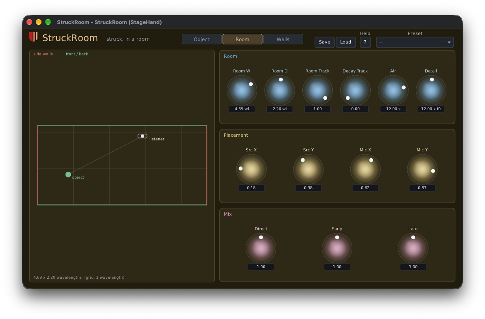

# StruckRoom

A struck instrument inside a room that scales with the note: somewhere between an instrument and a
reverb. It is [StruckSynth](https://github.com/erickampman/StruckSynth)'s struck object placed in a
room whose every length is measured in wavelengths of the note being played, so the object, the
walls, where it sits and the room's standing waves all transpose together.



| | |
|---|---|
| Formats | CLAP. VST3 and AUv2 (macOS) build from source; ready-built in a later preview |
| Platforms | Linux x86-64, macOS 26 or later on Apple Silicon. No Windows |
| Version | 0.9.0 (preview) |
| License | MIT |

**Downloads:** ready-built plugins will be on itch.io with the 0.9 preview. This repo has the
source only.

## What makes it different

- **A room tuned to the note.** Direct sound, four wall reflections, walls that can ring like struck
  objects of their own, and the room's standing waves (room modes), worked out at each strike.
  Where the object and the listener sit decides which modes are heard.
- **Walls that misbehave.** Each wall pair can shift its reflections in pitch, flex under loud notes
  and rattle once it rings hard enough.
- **Or a plain physical room.** Room Track and Decay Track at 0 give a fixed room, with decays in
  seconds, so notes fit more wavelengths as they rise.
- **MIDI 2.0 first.** The plugin takes MIDI 2.0 notes directly, so a Pitch 7.9 note plays its exact
  microtonal pitch, not the nearest semitone: an EDO keyboard such as
  [KeyboardEDO](https://github.com/erickampman/KeyboardEDO) is heard as played. Per-note pitch bend,
  Pitch 7.25 and per-note controllers reach only the note they name. MIDI 1.0 works too.
- **MPE and CLAP note expressions.** An MPE switch for MPE controllers, and in hosts that send CLAP
  notes (Bitwig) tuning, pressure and brightness arrive per note.

The editor has three tabs: **Object** (the struck object, as in StruckSynth), **Room** (the room seen
from above: drag the object and the listener) and **Walls** (the two wall pairs over a plot of every
room mode's decay). The [help page](Resources/help.md), also behind the editor's Help button,
describes every control. [docs/how-it-works.md](docs/how-it-works.md) has the room, the voice and
the MIDI 2.0 details.

## Known gaps

- **CPU.** Every voice carries its own room, so voices are expensive: Poly 4 is the default. On an
  M4 at 48 kHz a 4-note chord takes about 8% of a core at Detail 12 (the default), 24% at Detail 21
  and 41% at Detail 32. The help page says how to manage it.

## Installing

The download holds `StruckRoom.clap`. Put it in your CLAP folder (create the folder if it isn't there),
then rescan plugins in your host:

| | Linux | macOS |
|---|---|---|
| For you | `~/.clap` | `~/Library/Audio/Plug-Ins/CLAP` |
| For every user | `/usr/lib/clap` | `/Library/Audio/Plug-Ins/CLAP` |

On macOS, `~/Library` is hidden in Finder: Go ▸ Go to Folder opens it. The 0.9 previews aren't
notarized, so macOS won't load a downloaded plugin until its quarantine flag is cleared:

```bash
xattr -dr com.apple.quarantine ~/Library/Audio/Plug-Ins/CLAP/StruckRoom.clap
```

A host that is already running keeps the plugins it loaded: quit and restart it. To build StruckRoom
yourself instead, see below.

## Building from source

```bash
git clone https://github.com/erickampman/StruckRoom.git
cd StruckRoom
tools/fetch_deps.sh
cmake -B build -G Ninja -DCMAKE_BUILD_TYPE=Release
cmake --build build
```

[BUILDING.md](BUILDING.md) has what to install first on Linux and macOS, the tests, installing
the plugin for hosts, and the build options.

## Help and bugs

Questions and bug reports go to [GitHub Issues](https://github.com/erickampman/StruckRoom/issues).

## License

MIT. See [LICENSE](LICENSE) and [THIRD_PARTY_NOTICES.md](THIRD_PARTY_NOTICES.md).
